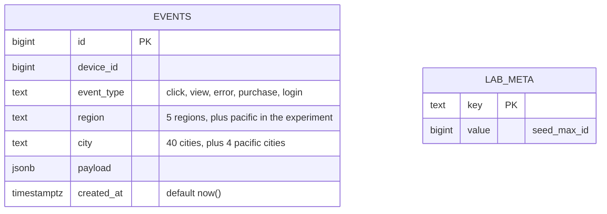
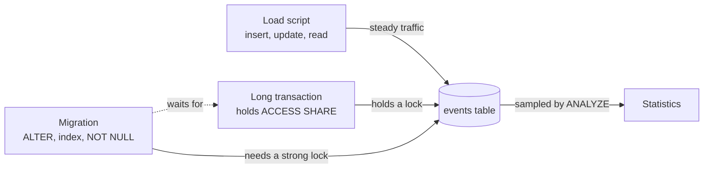

# Architecture: locks and migration

One busy table, a load that never stops, and the small tools that change the table while it runs. Component names follow the lesson's diagram ("The project: change a busy table without stopping it").

## Components

| Component | What it is | What it owns |
|---|---|---|
| **Load script** | `app/load.py` (`make load` runs it alone) | Steady traffic on `events`: 40 iterations a second of one insert, one update of a row inserted moments ago, and one read of recent events (120 operations a second, four connections). Its p99 is over single statements. Reports ops, errors and p99 once a second. A second's p99 counts the operations that finished in it and the age of any still waiting, so a full stall (nothing completes) shows as a high p99 instead of silence. Operations time out after 3 s and count as errors. |
| **events table** | PostgreSQL table `events` (2,000,000 rows by default; `ROWS=50000000` for the lesson's size) | The data, a primary key, and `idx_events_created_at` for the load's read. Schema in `sql/001_schema.sql`, seed in `002`. `lab_meta` records where the seed ended so the lab can delete everything the load and the experiments add. |
| **Statistics** | `pg_stats`, `pg_stats_ext`, `ANALYZE`, autovacuum | What the planner believes about `region` and `city`: per column after `ANALYZE`, and as a pair after `CREATE STATISTICS`. |
| **Long transaction** | `scenarios.hold_long_read()` | Session A: `BEGIN; SELECT ... WHERE id = 1;` and never commit. It holds an `ACCESS SHARE` lock on `events` for as long as it stays open. |
| **Migration** | `sql/migrations/001` to `006` and `app/migrate.py` | The three safe changes: the column (`001` add, `002` backfill batch), the index (`003`), `NOT NULL` (`004` to `006`). `migrate.py` adds what SQL files cannot: retry on `lock_timeout`, the batch loop with a pause, the lock report, and the interrupted-build helper. |
| **Scenarios and runner** | `app/scenarios.py`, `scripts/run_lesson.py` | Each experiment as a function returning plain data: the lock queue, the forced conflict, the backfill, plain and concurrent index builds, naive and safe `NOT NULL`, the plan flip. The runner chains them with long windows and writes `sql/explain/results.md`; the tests call the same functions with short windows. |
| **Tests** | `tests/` | One test per "Done when" line, run with the load script running. |

`sql/naive/` holds the three naive statements as plain files for a reader who wants to run them by hand in two `psql` sessions. `sql/experiments/` holds the plan-flip data load.

## Schema

`flagged boolean` is added by migration `001`, and `idx_events_device_created (device_id, created_at DESC)` by `003`. The two tables are unrelated; `lab_meta` is bookkeeping.

## Data flow of one run (`make run`)

1. **Reset and baseline.** `reset_lab` removes anything a previous run left (column, indexes, constraint, extended statistics, rows beyond the seed). The load starts and runs for `BASELINE_SECONDS` (60 by default; the lesson says ten minutes: `BASELINE_SECONDS=600`).
2. **The lock queue (step 2).** Session A reads and stays open. A second session runs `ALTER TABLE events ADD COLUMN flagged boolean` with no `lock_timeout`; it waits for A. The load's inserts, which only need a weak lock, now wait too. The runner snapshots `pg_stat_activity` and `pg_locks` mid-pile-up (saved as `sql/explain/lock_queue.txt`), then releases A and the queue drains.
3. **The safe migration (step 3).** A forced conflict shows the safe `ALTER` giving up at its `lock_timeout`. Then migration `001` adds the column and a default under a 2 s `lock_timeout` with retry, and the backfill fills old rows 2,000 ids at a time with a 0.05 s pause (the lesson starts at 10,000; see the decision below).
4. **The index (step 4).** A plain `CREATE INDEX` (naive) stalls writes for the build. A `CREATE INDEX CONCURRENTLY` is cancelled in its validation phase, which leaves an invalid index; the runner finds it in `pg_index`, drops it with `DROP INDEX CONCURRENTLY`, and rebuilds it under load.
5. **NOT NULL (step 5).** A naive `SET NOT NULL` on a scratch column shows the full scan under `ACCESS EXCLUSIVE`. Then the three moves on `flagged`: `CHECK ... NOT VALID`, `VALIDATE CONSTRAINT`, `SET NOT NULL` (and the now redundant `CHECK` is dropped). Each move reports the lock modes it held (read from `pg_locks` inside its own transaction) and its duration.
6. **The plan flip (step 6).** A month of correlated rows is loaded with autovacuum off for the table; the query is planned before statistics catch up, after `ANALYZE`, and after `CREATE STATISTICS`. Plans are saved as `f1_*`, `f2_*`, `f3_*`.
7. **Closing baseline.** Twenty more seconds of load. The bar for "within twice baseline" uses the higher of the opening and closing p99.

## Locks, in one table

| Statement | Lock on `events` | Blocks |
|---|---|---|
| `SELECT` | `ACCESS SHARE` | only `ACCESS EXCLUSIVE` |
| `INSERT`, `UPDATE`, `DELETE` | `ROW EXCLUSIVE` | `SHARE` and stronger |
| plain `CREATE INDEX` | `SHARE` | inserts, updates, deletes (reads continue) |
| `CREATE INDEX CONCURRENTLY`, `VALIDATE CONSTRAINT`, `VACUUM`, `ANALYZE` | `SHARE UPDATE EXCLUSIVE` | other schema changes and vacuums; not reads or writes |
| `ALTER TABLE ... ADD COLUMN`, `ADD CONSTRAINT`, `SET NOT NULL` | `ACCESS EXCLUSIVE` | everything |

Requests for one table are granted in the order they arrive. A request that cannot be granted yet (the `ALTER`, behind session A's `ACCESS SHARE`) waits in the queue, and any later request that conflicts with it, even a weak `ROW EXCLUSIVE` from an insert, waits behind it rather than overtaking. That is the whole of step 2.

## Decisions and trade-offs

- **Every strong lock gets a `lock_timeout` and a retry.** A migration that cannot get its lock in 2 s gives up, backs off and tries again, so it does not join the queue for good. The cost: a failed attempt still holds up the load for up to the timeout (the forced-conflict test shows about one second of stall for a 1 s timeout). In production use a short timeout, a few hundred milliseconds, and retry with backoff; the lesson's 2 s is the upper end.
- **Add the column nullable, then set a default.** Both are metadata-only changes in PostgreSQL 11 and later (the test checks the table's `relfilenode` does not change, so nothing was rewritten). New rows get `false` from the default; only rows that existed before need the backfill.
- **The backfill value is derived (`event_type = 'error'`).** A constant default would need no backfill at all in PostgreSQL 11 or later, which is the best answer when it applies. Deriving the value from other columns is what makes a batched backfill necessary.
- **Backfill in small batches, a pause apart, only rows still `NULL`.** One giant `UPDATE` holds row locks and generates WAL for its whole run. Small batches keep each transaction short, and the `flagged IS NULL` filter makes every batch safe to repeat. The range stops at the highest id present when the backfill starts; later rows already have the default.
- **The batch size is a measurement, not a constant.** The lesson starts at 10,000 rows. `make sweep` runs 10,000, 5,000 and 2,000 rows, each from a fresh database (`sql/explain/backfill-sweep.txt`). 10,000 had the highest p99 in both rounds of the committed sweep, with the load's insert p99 several times its baseline while updates and reads were untouched (per-operation figures from a separate sampling run). Sampling the load's sessions during the backfill showed them waiting on WAL (`WalSync`, `WALWrite`, `WalInit*`): a batch writes a few megabytes of WAL in one burst, and every commit behind it waits for the flush. Smaller bursts disappear more easily into the baseline, but p99 on a shared machine moves run to run, so the sweep repeats each arm. A fresh database is the hard case (new WAL segments have to be created and no table page has room for the new row versions); a table with free space and recycled WAL tolerates bigger batches.
- **Updating every row makes every row twice.** Each updated row is a new version, so the table roughly doubles until vacuum reuses the space, and it does not shrink on disk. That is the bloated table (`sql/explain/results.md` has the sizes). `VACUUM` frees the space for reuse inside the file; only `VACUUM FULL` or a rewrite returns it to the operating system, and that takes `ACCESS EXCLUSIVE`.
- **`CREATE INDEX CONCURRENTLY` and its leftovers.** It reads the table twice and waits for older transactions, so it is slower than a plain build, and it cannot run inside a transaction block. If it fails or is cancelled after the first phase, the index stays, marked invalid but already maintained by every write. The runner cancels in the validation phase on purpose, finds the leftover with `SELECT indexrelid::regclass FROM pg_index WHERE NOT indisvalid`, drops it with `DROP INDEX CONCURRENTLY`, and rebuilds. A unique concurrent build that meets a duplicate fails the same way.
- **NOT NULL by way of a check constraint.** `SET NOT NULL` alone scans the table under `ACCESS EXCLUSIVE`. With a validated `CHECK (flagged IS NOT NULL)` already in place, PostgreSQL 12 and later trusts it and skips the scan, so the final move is metadata-only. `VALIDATE CONSTRAINT` does the scan under `SHARE UPDATE EXCLUSIVE`, which lets reads and writes continue. The redundant `CHECK` is dropped in the same transaction as `SET NOT NULL` (the "contract" step).
- **Extended statistics: `dependencies` and `mcv`.** After `ANALYZE` the planner knows `region = 'pacific'` and `city = 'seattle'` separately and multiplies them as if independent, which underestimates by about 4.5 times here. The lesson asks for `dependencies`; this build adds `mcv`, which records the exact frequency of the common (region, city) pairs and is what brings the estimate within a few percent. Measured on this table: `dependencies` alone gives an estimate of about 60,000 (still 2.5 times low, because 'seattle' also appears, independently, in the seed's other regions, so the dependency is not exact), `mcv` alone about 149,000, both about 152,000, against 150,000 actual.
- **Autovacuum is switched off for `events` during the plan-flip experiment.** It would run an analyze once 10% of the table plus 50 rows have changed. The 600,000-row month is 30% of a 2,000,000-row table, so autovacuum would otherwise repair the statistics mid-experiment. The point of the experiment is the window before it does; production has autovacuum on and the window exists anyway for big loads.
- **The plan flip is a `LIMIT` plan.** `ORDER BY created_at DESC LIMIT 100` has two plans: walk `idx_events_created_at` backward until 100 rows match the filter, or scan everything, filter and sort. The first is right when matching rows are common. Expecting one matching row, the planner assumes walking the index would run to the end and picks the scan plus sort, which reads every row.
- **p99 with in-flight ages, and a bracketed baseline.** See the load script row above. The bar for "within twice baseline" uses the higher of the p99 measured before and after a change, because other work on the machine moves p99 as much as a migration does; no change is credited or blamed for a noisy minute.
- **Reads use the `created_at` index from the start.** The lesson reads with a predicate on `created_at`; without an index that would scan the whole table, and its 14 ms baseline implies there is one.
- **Checkpoints are spaced out (`max_wal_size = 8GB`, `checkpoint_timeout = 15min`).** The backfill writes more WAL than the default budget allows, and a checkpoint forced by WAL volume mid-backfill raised p99 past twice the baseline in an early run of the tests. Production servers set these for the same reason; with them the backfill's own cost is what the numbers show.
- **`min_wal_size = 2GB` and a `CHECKPOINT` at the end of the seed.** The seed's WAL is recycled into spare segments, so the first large write after it does not stall creating new WAL files (the load's sessions were seen waiting on `WalInit*`).
- **The container runs under an init process (`init: true`) and its health check connects over TCP.** With the postmaster as PID 1, a health-check process that exits non-zero (`pg_isready` returns 2 while the server is starting or recovering) is reaped by the postmaster, which reads it as a crash and restarts the server; on a busy machine that became a restart loop. The TCP check also keeps `make up` from returning while the image's temporary initialization server, which listens only on a socket, is the one answering.
- **Planner settings.** `max_parallel_workers_per_gather = 0` (server-wide in the compose file and per connection in `db.connect`). `log_lock_waits = on` and `deadlock_timeout = 1s` make PostgreSQL log any lock wait longer than a second; `docker compose logs db` shows the pile-up too.

## Failure modes the lesson teaches, and how to reproduce each

| Failure | Reproduce by hand | What you see |
|---|---|---|
| **The lock queue** | Session A: `BEGIN; SELECT * FROM events WHERE id = 1;` and leave it. Session B: `\i sql/naive/01_add_column_behind_a_long_transaction.sql`. Run the load (`make load`). Session C: `\i sql/003_queries.sql` or the two lock queries in it | B waits on A; every load statement waits on B (`pg_blocking_pids`); the ALTER's `AccessExclusiveLock` shows `granted = f`; p99 jumps to the 3 s timeout and errors appear. Commit A and it all drains. |
| **A plain index build** | Run `sql/naive/02_create_index_blocking_writes.sql` under load | Inserts and updates wait for the whole build (`ShareLock`); reads continue. The longest operation in `results.md` is about the build time. |
| **A scanning NOT NULL** | `sql/naive/03_set_not_null_scanning_the_table.sql` under load | `AccessExclusiveLock` for the length of a full scan; every query waits. |
| **An invalid index** | `make run` does it; by hand, start `CREATE INDEX CONCURRENTLY` from `sql/migrations/003_...` and cancel it with `SELECT pg_cancel_backend(pid) FROM pg_stat_progress_create_index;` while its phase starts with `index validation` | `SELECT indexrelid::regclass FROM pg_index WHERE NOT indisvalid;` lists it; `pg_index.indisready` is true, so it is maintained on every write. |
| **A bloated table** | `SELECT pg_size_pretty(pg_table_size('events')), n_dead_tup FROM pg_stat_user_tables WHERE relname = 'events';` before and after the backfill | The table grows by about the size of the updated rows and holds millions of dead versions until vacuum runs. |
| **A plan flip** | `psql < sql/experiments/01_bulk_load_correlated_month.sql`, then `sql/explain/f1_stale_statistics.sql` | `rows=1` estimated against 150,000 found, `Seq Scan` plus `Sort`, 2,450,000 or more rows removed by the filter. `ANALYZE` and then `CREATE STATISTICS` (see `scenarios.plan_flip`) move the estimate toward the truth and the plan to the index. |
| **A retry storm** | Run the safe migration while a long read is open | Each attempt waits the full `lock_timeout` in the queue before failing, and stalls the load that long each time: keep the timeout short. |

## Limits against production

- **Two million rows, not fifty million.** Every lock effect is the same at any size, but durations scale with the table: the plain index build that stalls writes for under a second here stalls them 25 times longer at 50,000,000 rows, and the validation scan and the backfill grow the same way. `ROWS=50000000 make db` builds the lesson's table (about 12 GB on disk); the numbers in this repository are from the default size.
- **One table, one database, one primary.** No replicas: a large backfill also produces replication lag, and with a synchronous standby every commit waits for it.
- **A tidy load.** Four connections, one statement per transaction. A real application has a pool that queues behind a lock, transactions that hold locks across calls, and a proxy that multiplies connections; a stalled table can exhaust all of them in seconds.
- **No guardrails turned on.** `idle_in_transaction_session_timeout` would have ended session A (the usual cause of the pile-up) after a set time, and statement timeouts on the application side limit the damage; both belong in production.
- **Laptop disk.** Commit latency here is Docker's virtual disk, which is slower and noisier than a server's. The bracketed baseline compensates for the noise; it cannot make the absolute numbers match another machine.
- **Autovacuum behaves differently at scale.** Its thresholds, cost limits and the interaction with a long backfill are not modeled.

## How to extend it

- **Partition by month and attach a partition without blocking the load.** Create `events_2026_11 (LIKE events INCLUDING ALL)`, add a `CHECK` constraint matching the bounds first, then `ATTACH PARTITION` (which then needs only a brief lock). Needs a partitioned parent, so this is a new `sql/` migration series.
- **Compare a single `UPDATE` with the batched backfill** on lock time, WAL volume (`pg_current_wal_lsn()` before and after) and replica lag.
- **Pin a plan.** Add `pg_hint_plan` or rewrite the query so that the estimate does not matter (for example by adding the `created_at` bound), and argue for or against it in a note next to `f1_stale_statistics.txt`.
- **MySQL.** Repeat step 4 with `ALGORITHM=INPLACE, LOCK=NONE` and compare with `CREATE INDEX CONCURRENTLY`.
- **A guardrail test.** Set `idle_in_transaction_session_timeout = '2s'` and show session A being ended and the queue draining by itself.
