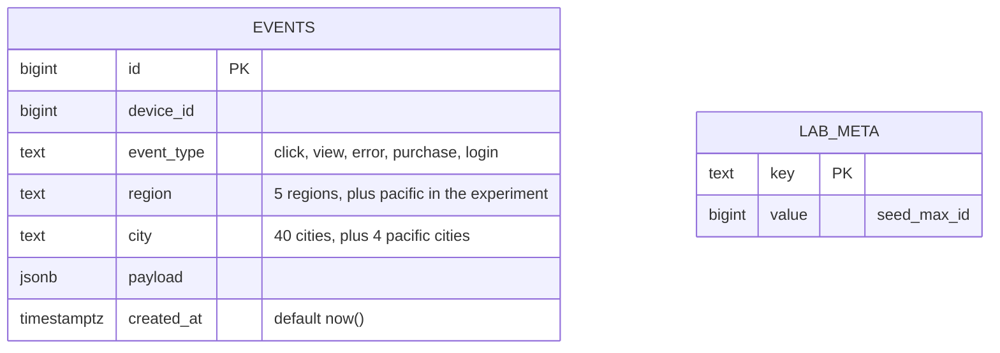
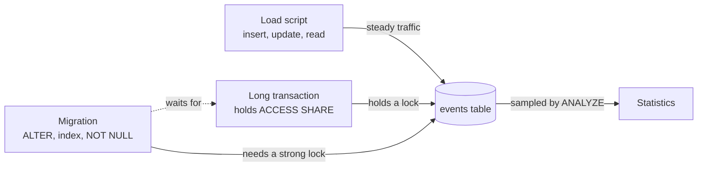

# Markdown and Mermaid

## What it is

**Markdown** is a way of writing formatted documents in plain text. You write `# Title` for a heading, `**bold**`, `- item` for a list, and a program (GitHub, an editor preview) turns it into a nicely formatted page. Every `.md` file in this repository is Markdown. **Mermaid** is a small language for drawing diagrams from text; GitHub and many editors draw a Mermaid block as a picture, so diagrams live in the same file as the words and can be changed with a normal text edit.

## Why this repository uses it

The documentation is part of the product: a README that proves every "Done when" line with the numbers of a measured run, an ARCHITECTURE document that names the pattern and draws the lock relationships, a changelog, two decision records, a results file and a lock-queue capture written by the program, and these notes. All of it is Markdown, so it is read on GitHub and in any editor.

## Where it appears

| File | What it is |
|---|---|
| `README.md` | How to set up, run and test; the proofs of each "Done when" line; the project tree. |
| `ARCHITECTURE.md` | The pattern, the components, the schema (a Mermaid `erDiagram`) and the data flow (a Mermaid `flowchart`). |
| `CHANGELOG.md` | Keep a Changelog format, version 0.1.0. |
| `docs/adr/0001-experiments-as-use-cases-over-ports.md`, `0002-backfill-batch-size-is-a-measurement.md` | Decision records. |
| `sql/explain/results.md` | Written by the program: the windows table, the lock queue, the findings of each step and the plan-flip table. |
| `tech/*.md` | These notes. |

## How it works underneath

**Markdown syntax used here.**

| You write | You get |
|---|---|
| `# Heading`, `## Subheading`, ... | headings of levels 1, 2, ... |
| a blank line | a new paragraph |
| `- item` or `1. item` | a bullet or numbered list |
| `**bold**`, `*italic*` | bold, italic |
| `` `code` `` | inline code in a fixed-width font |
| three backticks, an optional language name, lines, three backticks | a **code block** (``` ```python ```), shown as is, with colours for the named language |
| `[text](https://address)` | a link |
| `\| a \| b \|` rows with a line of `\|---\|---\|` under the first | a table; `:` in the dashes aligns a column (`---:` right) |
| `> text` | a quotation |

Markdown is plain text first: it is readable without any program. Different programs add small extensions (tables and task lists are "GitHub Flavored Markdown"). Two spaces at the end of a line can force a line break, which is why `.editorconfig` does not trim trailing spaces in `.md` files.

**Mermaid.** A code block whose language is `mermaid` holds a diagram description. The first word chooses the diagram type:

- `flowchart LR` (boxes and arrows, left to right). A node is `id["label"]`; `id[("label")]` is drawn as a database cylinder; `a --> b` is an arrow; `a -->|"text"| b` an arrow with a label; `<br/>` is a line break inside a label.
- `erDiagram` (entity-relationship: tables and their columns). `NAME { type column KEY "comment" }` lists a table's columns; `PK` marks a primary key.

The picture is drawn by the viewer; the text stays in the file.

**Documents of other kinds in this repository** are also Markdown: `CHANGELOG.md` follows the Keep a Changelog convention (a section per released version with `Added`, `Changed`, `Fixed` lists); `docs/adr/NNNN-title.md` are **architecture decision records** (a short document per real decision: context, decision, consequences); `tech/` is these notes.

## Walkthrough of this repository's use

### The two Mermaid diagrams

`ARCHITECTURE.md`, lines 41 to 56:

````markdown

````

`erDiagram` starts an entity-relationship diagram. Each block (`EVENTS { ... }`, `LAB_META { ... }`) is a table; each line inside is `type column [key] ["comment"]`. `PK` marks the primary key; the quoted text after a column is shown as a note ("5 regions, plus pacific in the experiment").

`ARCHITECTURE.md`, lines 62 to 69:

````markdown

````

`flowchart LR` draws left to right. `load["Load script<br/>insert, update, read"]` is a node with an id (`load`) and a label in quotes, with `<br/>` for a line break. `events[("events table")]` draws a cylinder, the symbol for a database. `load -->|"steady traffic"| events` is an arrow with a label. `mig -.->|"waits for"| long` is a **dotted** arrow (`-.->`): the migration waits for the long transaction. The diagram shows the lesson's central picture in five lines: three actors want the same table; the migration needs the strongest lock and so waits for a holder.

### The results file written by the program

`src/locks_lab/application/report.py`, lines 14 to 33:

```python
def _row(label: str, window: WindowSummary, bar: Bar) -> str:
    verdict = "yes" if bar.allows(window) else "no"
    return (
        f"| {label} | {window.ops_per_second} | {window.errors} | {window.p99_ms} | {window.max_ms} | "
        f"{window.worst_second_p99_ms} | {window.stalled_seconds} | {verdict} |"
    )


def render_results(result: LessonResult) -> str:
    """Markdown with the windows table, the lock queue, each step's findings and the plan-flip table."""
    bar, queue, safe = result.bar, result.lock_queue, result.safe
    plain, concurrent = result.plain_index, result.concurrent_index
    naive, moves = result.naive_not_null, result.safe_not_null
    out = [
        "# Results of the last `make run` or `make measure`",
        "",
        f"Generated by `locks-lab-run` on {result.rows:,} rows with the load running throughout "
        f"({result.baseline_seconds} s baseline). The load is 40 iterations a second of insert, update and read "
        "(120 operations a second).",
        "",
```

`render_results` builds Markdown lines in Python: `"# Results of the last `make run` or `make measure`"` is a heading; the line starting `| Window | Ops/s | ... |` is the table header and `"|---|---:|---:|..."` the separator row in which `---:` right-aligns the numbers. The lock queue is placed in a fenced block with `"```text"` and `"```"`. Each data row is an f-string with the same number of `|` separators.

### The changelog and the decision records

`CHANGELOG.md`, lines 1 to 8:

```markdown
# Changelog

All notable changes to this project are recorded here. The format follows [Keep a Changelog](https://keepachangelog.com/en/1.1.0/) and the project uses [Semantic Versioning](https://semver.org/).

## [0.1.0] - 2026-10-27

### Added

```
`docs/adr/0002-backfill-batch-size-is-a-measurement.md`, lines 1 to 12:

```markdown
# 0002. The backfill batch size is a measurement, not a constant

Status: accepted, 2026-10-27

## Context

The lesson starts the backfill at 10,000 rows per batch with a pause. On this laptop-sized lab, from a freshly loaded database, 10,000-row batches gave the load the highest p99 in both rounds of the sweep (`sql/explain/backfill-sweep.txt`): each batch writes its WAL in one burst and the load's commits queue behind the flush. 5,000 and 2,000 rows were gentler but not immune, and p99 on a shared machine moves by a factor of two or three between runs.

## Decision

The default is 2,000 rows with a 0.05 s pause, configurable (`BACKFILL_BATCH`, `BACKFILL_PAUSE_SECONDS`). Comparisons of batch sizes start every arm from a fresh database, because the first pass over a freshly loaded table is the expensive one. The README and results say which size was used.

```

The changelog has a heading per version (`## [0.1.0] - 2026-10-27`) and sub-headings `### Added`. A decision record has the fixed parts `Status`, `Context`, `Decision`, `Consequences`. This one records why the backfill batch is 2,000 rows and not the lesson's 10,000 and why the figure is configurable.

## Try it yourself

1. Open `ARCHITECTURE.md` on GitHub, or in an editor with a Markdown preview, to see the two diagrams drawn.
2. Paste the flowchart block into https://mermaid.live to edit it and watch the picture change (try turning `mig -.->` into `mig -->`).
3. `grep -c '```mermaid' ARCHITECTURE.md` prints `2`.
4. `head -12 sql/explain/results.md` — the generated tables in raw Markdown; paste them into a previewer to see them as tables.
5. `.venv/bin/python -c "print(open('CHANGELOG.md').read().splitlines()[0])"` prints `# Changelog`.

## Mistakes people make

- Forgetting the blank line before a list or a table, so it is shown as plain text.
- Not closing a code block (three backticks), so the rest of the page turns into code.
- Putting a literal `|` inside a table cell without escaping it.
- Making diagrams so large that nobody can read them.
- Hard-wrapping lines inconsistently, which makes diffs noisy.

**How this repository avoids them.** Every code block is closed; tables have blank lines before them; diagrams are small; `.editorconfig` keeps trailing spaces in `.md` files; generated Markdown comes from one function that is unit-tested (`test_report.py`).

## Check yourself

1. How do you write a level-2 heading? *Start a line with `## `.*
2. How do you show a command as code? *Put it in backticks for inline code, or in a fenced block with three backticks.*
3. What does a Mermaid block contain? *A diagram described as text, drawn by the viewer.*
4. What does `a -->|"text"| b` draw? *An arrow from node a to node b labelled "text".*
5. What is an ADR? *An architecture decision record: a short document giving the context, the decision and the consequences of one real choice.*

## Further reading

- CommonMark specification (the base of Markdown): https://spec.commonmark.org/ ; GitHub Flavored Markdown: https://github.github.com/gfm/
- Mermaid documentation: https://mermaid.js.org/intro/ (flowchart: https://mermaid.js.org/syntax/flowchart.html ; entity relationship: https://mermaid.js.org/syntax/entityRelationshipDiagram.html)
- Keep a Changelog 1.1.0: https://keepachangelog.com/en/1.1.0/ ; ADRs: https://adr.github.io/
